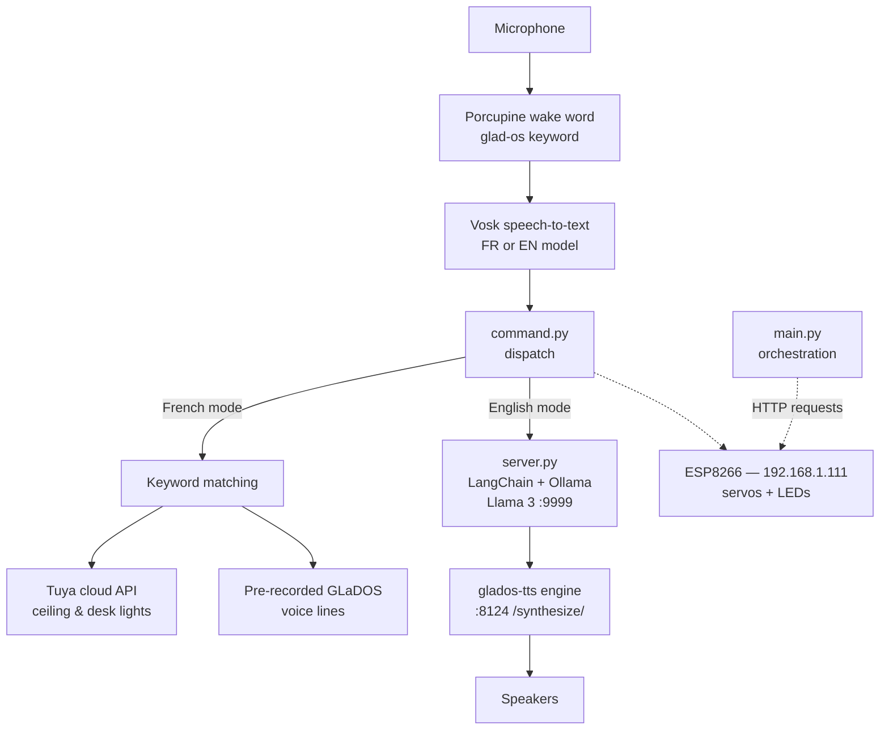

# GLaDOS

> *I unplugged my Google Home. I built my own.*

A fully local, sarcastic voice assistant inspired by GLaDOS from *Portal*. No requests to Google, no OpenAI API, no cloud, everything runs on a regular consumer PC, plus a motorized 3D-printed head on an ESP8266.

**▶️ [Watch the video](https://youtu.be/4LW9Yb6zW9s)**

[](https://youtu.be/4LW9Yb6zW9s)

---

## About

This project merges three passions: robotics, AI, and 3D printing. The result fits on a shelf: a motorized head, a chassis entirely modeled by hand in Fusion 360, an ESP8266 driving the motors to look in every direction, and a few LEDs.

The brain runs locally with Llama 3 via [Ollama](https://ollama.com). It uses a hybrid system:

- **In French**, it detects the keyword `"GLaDOS"` and triggers instant responses for home automation (no LLM, no latency).
- **In English**, Llama 3 improvises in full conversation, with a system prompt that forces the sarcasm and passive-aggressive tone of the *Portal* games.

The voice? A neural TTS model specifically trained to clone the one from the game it comes from.

## Demo

[](https://youtu.be/4LW9Yb6zW9s)

*Watch the full video on YouTube.*

## Features

- **Wake word** — `"GLaDOS"` detected offline with [Picovoice Porcupine](https://picovoice.ai) and a custom keyword model
- **Offline speech recognition** — [Vosk](https://alphacephei.com/vosk/) with small French and English models
- **French mode** — instant keyword-based commands: greetings, jokes, and home automation via the Tuya API (ceiling and desk lights)
- **English mode** — full conversation with Llama 3 running locally, forced into GLaDOS's sarcastic, passive-aggressive *Portal* persona
- **Custom GLaDOS voice** — a neural TTS engine (Forward Tacotron + HiFiGAN) trained on Ellen McLain voice lines
- **Motorized head** — 3 servos (turn / tilt / translate) controlled by an ESP8266 over Wi-Fi through a simple HTTP API
- **Reactive LEDs** — RGB status LED, and a "core" LED that change with the assistant's state (asleep, awake, listening, processing, talking)
- **Idle behaviors** — random head movements and LED flickers while talking, auto-sleep after 30 s of inactivity
- **Gamepad control** — drive the head, change colors, and toggle talk mode with a joypad
- **Face tracking** *(experimental, disabled)* — OpenCV-based head pointing, abandoned in practice (see [Known limitations](#known-limitations))

## How it works



1. **Wake word** — Porcupine continuously listens for `"GLaDOS"` on the configured microphone.
2. **Transcription** — Vosk converts the speech to text (French or English model depending on the mode).
3. **Dispatch** (`command.py`) —
   - *French mode*: simple keyword matching triggers pre-recorded GLaDOS voice lines and Tuya light commands. Instant, deterministic, no LLM.
   - *English mode*: the text is sent over a TCP socket to `server.py`, which runs Llama 3 through Ollama with a GLaDOS system prompt. The response is then synthesized by the local TTS engine (`http://<host>:8124/synthesize/...`) and played back.
4. **Body language** — throughout the pipeline, `gladosMove.py` sends HTTP requests to the ESP8266 (`/api?Turn=...`, `/api?Tilt=...`, `/api?SecLed=...`, ...) to animate the head and update the LEDs.


## Software stack

| Layer | Tech |
| --- | --- |
| Orchestration | Python 3, PyAudio, pydub |
| Wake word | Picovoice Porcupine (custom `glad-os` keyword) |
| Speech-to-text | Vosk (small FR 0.22 / EN 0.15 models) |
| LLM | [Ollama](https://ollama.com) + Llama 3, wrapped with LangChain |
| Text-to-speech | [glados-tts](https://github.com/R2D2FISH/glados-tts) — Forward Tacotron + HiFiGAN (PyTorch) |
| Home automation | Tuya IoT SDK (Smart Life lamps) |
| Gamepad | pygame |
| Face tracking *(experimental)* | OpenCV (Haar cascades) |
| Firmware | Arduino — Servo, FastLED, ESP8266WebServer |

## Project structure

```
.
├── main.py                  # Entry point: wake word → STT → command loop
├── wake_word.py             # Porcupine wake-word detection
├── speechRecog.py           # Vosk speech recognition (FR / EN)
├── command.py               # Command dispatch: FR keywords or EN LLM pipeline
├── server.py                # Local LLM server (Ollama + Llama 3, port 9999)
├── gladosMove.py            # HTTP client for the ESP8266 (servos + LEDs)
├── light.py                 # Tuya light control (ceiling & desk)
├── controller.py            # Gamepad remote control (pygame)
├── faceRecog.py             # Experimental OpenCV face tracking
├── off.py                   # Graceful shutdown script
├── configInputDevice.py     # Microphone setup wizard
├── configOutputDevice.py    # Speaker setup wizard
├── glados/                  # ESP8266 firmware (glados.ino, mdp.h)
├── glados-tts/              # Neural TTS engine (voice server, port 8124)
├── voiceLine/               # Pre-recorded GLaDOS voice lines (FR)
├── WakeWord/                # Porcupine access key + custom keyword file
├── speechRecognition/       # Vosk models (FR & EN)
├── Tuya/                    # Tuya API credentials (Key.py)
├── MAIN FR.bat              # Launch in French
├── MAIN EN.bat              # Launch in English (full conversation)
├── LAUNCHER SERVER.bat      # Launch the LLM server + TTS engine
├── CONTROLLER.bat           # Gamepad control
└── OFF.bat                  # Shut GLaDOS down
```

## Getting started

### Prerequisites

- Windows PC (the scripts and device enumeration are Windows-oriented)
- Python 3 with pip
- [Ollama](https://ollama.com) with the Llama 3 model pulled (`ollama run llama3`)
- An ESP8266 flashed with `glados/glados.ino` (Arduino IDE, libraries: `Servo`, `FastLED`)
- Speakers and a microphone

### 1. Configure audio devices

```console
python configInputDevice.py
python configOutputDevice.py
```

Each script lists your audio devices and saves the selected one to `configInputDevice.txt` / `configOutputDevice.txt`.

### 2. Flash the ESP8266

1. Put your Wi-Fi SSID and password in `glados/mdp.h`.
2. Flash `glados/glados.ino` with the Arduino IDE.
3. The board requests the static IP `192.168.1.111` — adjust it in the sketch and in `gladosMove.py` if your network differs.

### 3. Set up the wake word

1. Grab a free access key from the [Picovoice Console](https://console.picovoice.ai).
2. Save it in `WakeWord/Porcupine/KEY.key`.
3. The custom `glad-os_en_windows_v3_0_0.ppn` keyword file is already in `WakeWord/Porcupine/`.

### 4. Set up the TTS engine

The voice is the excellent [glados-tts](https://github.com/R2D2FISH/glados-tts) by R2D2FISH (MIT license):

1. Download the model files from the [Google Drive link in its README](https://github.com/R2D2FISH/glados-tts) and unzip them into `glados-tts/`.
2. Install its dependencies: `pip install -r glados-tts/requirements.txt`.
3. `voice.bat` starts the engine on port `8124`. The English pipeline calls it at `http://127.0.0.1:8124/synthesize/<text>`.

### 5. Home automation (optional, French mode)

1. Create a [Tuya IoT Platform](https://developer.tuya.com) project and link your Smart Life lamps.
2. Fill in `Tuya/Key.py` with your endpoint, access ID/key, account credentials, and the device IDs for the ceiling (`DEVICE_ID_PLAFOND`) and desk (`DEVICE_ID_BUREAU`) lights.

### 6. Run it

| You want... | Run |
| --- | --- |
| French mode (instant commands + lights) | `MAIN FR.bat` |
| English mode (full GLaDOS conversation) | `LAUNCHER SERVER.bat`, wait for the server and TTS engine to start, then `MAIN EN.bat` |
| Gamepad control | `CONTROLLER.bat` |
| Shutdown | `OFF.bat` |

Say **"GLaDOS"**, wait for the eye to light up, and talk.

## Known limitations

- **Face tracking is abandoned.** OpenCV running on top of a local LLM saturated the GPU, so the head now moves with randomized idle behaviors instead. The code is kept in `faceRecog.py` and toggled by the `faceRecognition` flag in `main.py`.
- **The two modes are very different.** French mode is keyword-based (fast, deterministic, but rigid). Only the English mode talks to Llama 3.
- **IP addresses are hardcoded.** The ESP8266 lives at `192.168.1.111` and the LLM/TTS servers at `127.0.0.1` — update `gladosMove.py` and `command.py` for your network.
- **Windows-first.** Device enumeration and the `.bat` launchers assume Windows.

## Credits

- [R2D2FISH/glados-tts](https://github.com/R2D2FISH/glados-tts) — the GLaDOS neural voice (MIT)
- [Picovoice Porcupine](https://picovoice.ai) — offline wake word
- [Vosk](https://alphacephei.com/vosk/) — offline speech recognition
- GLaDOS and *Portal* are creations of Valve — this is a loving fan tribute.
